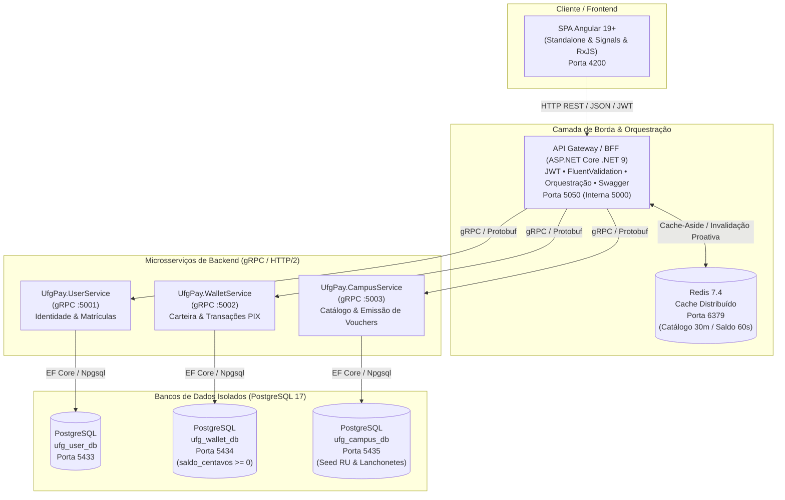

# 🏛️ UFG Pay - Sistema Distribuído de Pagamentos Acadêmicos

Sistema distribuído de carteira digital e pagamentos acadêmicos para a **Universidade Federal de Goiás (UFG)**, integrando Restaurante Universitário (RU Samambaia e Colemar), reprografia (Xerox), lanchonetes e taxas acadêmicas (Biblioteca e PROGRAD).

O projeto adota uma arquitetura baseada em **Microsserviços**, **Clean Architecture**, **SOLID**, **Database-per-Service**, comunicação de alto desempenho via **gRPC**, cache distribuído com **Redis** e um **Frontend SPA reativo em Angular 19+**.

---

## 📐 Visão Arquitetural

A arquitetura do **UFG Pay** desacopla completamente os domínios de identidade acadêmica, finanças e consumo no campus, garantindo alta disponibilidade, tolerância a falhas, baixa latência e integridade transacional financeira.



---

## 💡 Princípios e Padrões Arquiteturais Implementados

### 1. Database-per-Service (Isolamento Estrito de Dados)
- Cada microsserviço gerencia sua própria base de dados relacional PostgreSQL independente (`ufg_user_db`, `ufg_wallet_db`, `ufg_campus_db`).
- Nenhum serviço acessa tabelas de outro serviço diretamente. Toda integração de dados é realizada via interfaces gRPC tipadas no API Gateway.

### 2. API Gateway / BFF (Backend-For-Frontend)
- Ponto centralizado de entrada externa para a aplicação cliente.
- Responsável por:
  - **Terminação de autenticação JWT**: Validação de claims e extração segura do `UserId`.
  - **Validação de contratos**: Regras de validação estritas usando `FluentValidation`.
  - **Orquestração de negócio composta**: Exemplo do registro de usuário (criação do perfil no `UserService` e inicialização atômica da carteira no `WalletService`).
  - **Padrão de Compensação no Checkout**: Se o débito for efetuado com sucesso na carteira, mas o `CampusService` falhar ao gerar o voucher, o Gateway dispara automaticamente um estorno de compensação para a carteira do aluno.
  - **Tratamento Global de Erros**: Middleware padronizado que encapsula falhas gRPC e de banco em respostas HTTP padronizadas.

### 3. Comunicação Inter-serviços via gRPC / HTTP/2
- Tráfego interno de alta performance e baixa latência baseado em binários Protocol Buffers (`proto3`).
- Contratos versionados e compartilhados centralizados no diretório `/proto`:
  - `user_service.proto`: Autenticação e gestão de usuários.
  - `wallet_service.proto`: Criação de contas, consulta de saldo, depósito PIX e débitos.
  - `campus_service.proto`: Listagem do catálogo e processamento de vouchers de consumo.

### 4. Cache Distribuído com Redis 7.4
- **Catálogo do Campus**: Estratégia *Cache-Aside* com TTL de 30 minutos (`ufgpay:campus:services`), aliviando as consultas de leitura frequente no Restaurante Universitário.
- **Saldo de Carteira**: Cache de leitura ultrarrápido com TTL de 60 segundos (`ufgpay:wallet:balance:{userId}`).
- **Invalidação Proativa de Cache**: Ao realizar recarga PIX ou checkout de compra, a chave de saldo no Redis é imediatamente purgada.

### 5. Integridade Transacional e Precisão Financeira
- **Valores em Centavos (`BIGINT` / `int64`)**: Nenhum cálculo financeiro utiliza tipos de ponto flutuante (`float`/`double`), eliminando imprecisões decimais.
- **Restrição a Nível de Banco**: A tabela `contas` possui a constraint `CONSTRAINT chk_saldo_positivo CHECK (saldo_centavos >= 0)`, impedindo saldos negativos mesmo sob condições de corrida.

### 6. Frontend Reativo e Modular (Angular 19+)
- **Arquitetura Standalone**: Componentes independentes sem uso de módulos legados (`NgModules`).
- **Angular Signals & RxJS**: Reatividade moderna para sincronização instantânea de saldo e estado de autenticação.
- **Separação de Responsabilidades**: Arquitetura em camadas desacopladas (`core/`, `features/`, `shared/`).
- **Interceptors HTTP**: Injeção automática de Bearer Token (`auth.interceptor.ts`) e tratamento global de erros/expiração (`error.interceptor.ts`).
- **Nginx Container**: Servido sob contêiner otimizado com suporte a roteamento HTML5 e fallback de rotas SPA.

---

## 📁 Estrutura do Repositório

```text
UFGPay/
├── proto/                                      # Contratos agnósticos Protocol Buffers (.proto)
│   ├── user_service.proto
│   ├── wallet_service.proto
│   └── campus_service.proto
│
├── app/
│   ├── backend/
│   │   ├── gateway/
│   │   │   └── UfgPay.Gateway/                # API Gateway REST + BFF + Redis Cache
│   │   │       ├── Controllers/               # Auth, Wallet e Campus Controllers
│   │   │       ├── Application/               # DTOs, Interfaces e Validadores FluentValidation
│   │   │       ├── Infrastructure/            # Cache Redis e Serviços JWT
│   │   │       ├── Middlewares/               # ExceptionHandling e JwtAuth Middleware
│   │   │       └── Dockerfile
│   │   └── services/
│   │       ├── UfgPay.UserService/           # Microsserviço gRPC de Identidade e Matrículas
│   │       │   ├── Domain/                    # Entidades e Interfaces de Repositório
│   │       │   ├── Application/               # Serviços de Negócio e Hashing de Senhas
│   │       │   ├── Infrastructure/            # EF Core DbContext, Repositórios e Migrations SQL
│   │       │   ├── Grpc/                      # Implementação do UserGrpcService
│   │       │   └── Dockerfile
│   │       ├── UfgPay.WalletService/         # Microsserviço gRPC de Carteira e PIX
│   │       │   ├── Domain/                    # Conta, Transação e Regras Financeiras
│   │       │   ├── Application/               # Transações de Depósito PIX e Débito
│   │       │   ├── Infrastructure/            # EF Core DbContext e Migrations SQL
│   │       │   ├── Grpc/                      # Implementação do WalletGrpcService
│   │       │   └── Dockerfile
│   │       └── UfgPay.CampusService/         # Microsserviço gRPC de Catálogo e Vouchers
│   │           ├── Domain/                    # Estabelecimento, Serviço e Pedido de Consumo
│   │           ├── Application/               # Emissão de Vouchers Criptográficos
│   │           ├── Infrastructure/            # EF Core DbContext, Migrations e SeedData.sql
│   │           ├── Grpc/                      # Implementação do CampusGrpcService
│   │           └── Dockerfile
│   └── frontend/
│       └── ufg-pay-web/                      # SPA Angular 19+ (Standalone + Signals)
│           ├── src/
│           │   ├── app/
│           │   │   ├── core/                  # Guards, Interceptors, Models e Serviços Centrais
│           │   │   ├── features/              # Telas de Auth, Dashboard, PIX e Catálogo/RU
│           │   │   └── shared/                # Navbar, Footer, Toast e BRL Currency Pipe
│           │   └── styles.scss                # Design System institucional UFG
│           ├── nginx.conf                     # Configuração otimizada Nginx
│           └── Dockerfile
│
├── docs/
│   └── adr/
│       └── adr0001.md                         # Registro de Decisões Arquiteturais (ADRs)
├── infra/
│   └── README.md                              # Reservado para Módulos Terraform IaC
└── docker-compose.yml                         # Orquestração multicontêiner completa do ecossistema
```

---

## 🔌 Portas e Mapeamento de Serviços

| Serviço | Tipo | Porta Externa | Porta Interna | Descrição |
| :--- | :--- | :--- | :--- | :--- |
| **Frontend Web** | HTTP | `4200` | `80` | Interface do Aluno/Servidor (Angular + Nginx) |
| **API Gateway / BFF** | HTTP / REST | `5050` | `5000` | Ponto único de entrada, Swagger e orquestração |
| **UfgPay.UserService** | gRPC | `5001` | `5001` | Serviço interno de autenticação acadêmica |
| **UfgPay.WalletService** | gRPC | `5002` | `5002` | Serviço interno de carteira e PIX |
| **UfgPay.CampusService** | gRPC | `5003` | `5003` | Serviço interno de catálogo e vouchers |
| **Redis** | In-Memory DB | `6379` | `6379` | Cache-aside de catálogo e saldos |
| **PostgreSQL User DB** | Banco Relacional | `5433` | `5432` | Base de dados de usuários (`ufg_user_db`) |
| **PostgreSQL Wallet DB** | Banco Relacional | `5434` | `5432` | Base de dados financeira (`ufg_wallet_db`) |
| **PostgreSQL Campus DB** | Banco Relacional | `5435` | `5432` | Base de dados do RU e serviços (`ufg_campus_db`) |

---

## 📡 Endpoints da API REST (Gateway)

A documentação interativa com Swagger pode ser acessada em: **`http://localhost:5050`**

### 🔐 Autenticação (`/api/v1/auth`)
- `POST /api/v1/auth/register`: Cadastra um novo aluno/servidor e inicializa automaticamente a carteira com saldo R$ 0,00. Retorna JWT.
- `POST /api/v1/auth/login`: Autentica o usuário institucional via matrícula e senha. Retorna JWT com claims acadêmicas.

### 💰 Carteira Digital (`/api/v1/wallet`) *(Requer Bearer Token)*
- `GET /api/v1/wallet/balance`: Consulta saldo em centavos e reais (cache Redis de 60s).
- `POST /api/v1/wallet/topup-pix`: Realiza recarga instantânea simulada via PIX e purga cache de saldo.

### 🍽️ Catálogo do Campus & Checkout (`/api/v1/campus`)
- `GET /api/v1/campus/services`: Lista estabelecimentos e itens de consumo disponíveis (com cache-aside Redis de 30m).
- `POST /api/v1/campus/checkout`: *(Requer Bearer Token)* Orquestra atomicamente o débito na carteira e a geração do código do voucher para apresentação no balcão do RU/lanchonete. Em caso de falha na emissão, aciona estorno de compensação automático.

---

## 🚀 Como Executar o Projeto

### Pré-requisitos
- **Docker Desktop** (com suporte a WSL2 no Windows ou daemon nativo no Linux/macOS) instalado e em execução.

### Inicialização Rápida

1. Clone o repositório e navegue até a raiz do projeto:
   ```bash
   git clone https://github.com/robert-alves/UFGPay.git
   cd UFGPay
   ```

2. Suba todos os microsserviços, bancos de dados, cache e frontend com um único comando:
   ```bash
   docker compose up -d --build
   ```

3. Verifique o status dos contêineres:
   ```bash
   docker compose ps
   ```

### Acesso aos Ambientes
- 🌐 **Aplicação Web (Angular)**: [http://localhost:4200](http://localhost:4200)
- 📑 **Swagger API Gateway**: [http://localhost:5050](http://localhost:5050)
- 📊 **Catálogo Inicial Pré-carregado**: O banco do Campus é provisionado com cardápio do RU Samambaia e Colemar (refeição a R$ 4,00, café da manhã a R$ 2,50), além de serviços de reprografia e lanchonetes.

---

## 🧪 Roteiro de Teste do Fluxo E2E

1. **Cadastre-se na Aplicação**:
   - Abra [http://localhost:4200/register](http://localhost:4200/register).
   - Preencha com nome, matrícula (ex: `202410123`), e-mail `@ufg.br` e senha.
   - O sistema criará o usuário e inicializará sua conta com saldo zero.
2. **Efetue uma Recarga PIX**:
   - Acesse a aba **Recarga PIX** e simule uma recarga (ex: R$ 20,00).
   - O saldo será atualizado instantaneamente no painel.
3. **Compre uma Refeição no RU**:
   - Acesse o **Catálogo do RU / Campus**.
   - Selecione a refeição do estudante (R$ 4,00) e confirme o pagamento.
   - O saldo será debitado e um **Voucher Digital Único** será emitido com código alfanumérico para validação.
4. **Verificação de Resiliência**:
   - Consulte o saldo no Swagger ou no Frontend para notar a consistência dos dados e a invalidação automática de cache.

---

## 🏛️ Dados de Seed (Catálogo Pré-configurado)

O serviço `UfgPay.CampusService` já inicializa com os principais pontos e serviços da universidade:
- **Restaurante Universitário (Samambaia & Colemar)**: Almoço/Jantar Estudante (R$ 4,00), Café da Manhã (R$ 2,50), Visitante/Servidor (R$ 14,00).
- **Reprografia Central**: Cópias P&B (R$ 0,25), Impressões Coloridas (R$ 1,00), Plotagens e Encadernações.
- **Lanchonete do INF**: Café Expresso (R$ 3,50), Salgados Assados (R$ 7,00), Pão de Queijo Goiano (R$ 4,50).
- **Biblioteca Central & PROGRAD**: Multas por atraso e 2ª via de carteirinha digital.

---

## 📄 Licença e Governança

Projeto desenvolvido como parte do ecossistema de soluções tecnológicas para a **Universidade Federal de Goiás (UFG)**. Consulte os [Registros de Decisões Arquiteturais (ADRs)](docs/adr/adr0001.md) para detalhes técnicos de governança.
