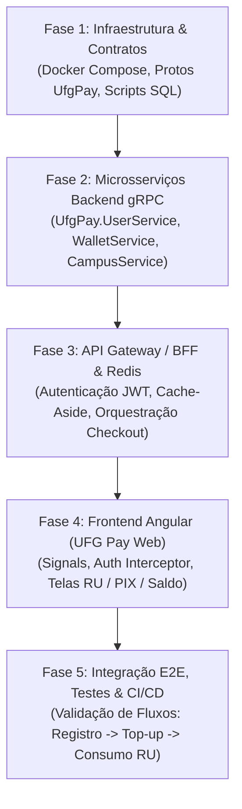

# ADR 0001: Definição Arquitetural e Planejamento do UFG Pay

## Status
**Aceito** (2026-10-15)

---

## 1. Contexto

A Universidade Federal de Goiás (UFG) necessita de um ecossistema distribuído de pagamentos e consumo interno para atender seus campi, integrando Restaurante Universitário (RU), reprografia (Xerox), lanchonetes e taxas acadêmicas.

Anteriormente, o rascunho de concepção utilizava a nomenclatura *UFG Bank*. No entanto, o sistema deve ser oficialmente denominado **UFG Pay**, refletindo sua natureza de carteira digital e gateway de consumo acadêmico. Além disso, os requisitos exigem isolamento estrito de domínios, tolerância a falhas, consistência transacional financeira e alto desempenho.

---

## 2. Decisões de Arquitetura

### 2.1. Nomenclatura e Domínio
- O projeto adota oficialmente o nome **UFG Pay** em todos os artefatos, namespaces de código, contratos de API/RPC, contêineres Docker e branding visual.

### 2.2. Padrão Arquitetural
- **Database-per-Service**: Cada microsserviço de negócio possui seu próprio banco de dados relacional isolado.
- **API Gateway / Backend-For-Frontend (BFF)**: Ponto único de entrada para clientes externos, responsável por terminação TLS/HTTP, autenticação/autorização JWT, validação de payload, cache distribuído e orquestração de chamadas internas.
- **Comunicação Inter-serviços via gRPC**: Toda a comunicação síncrona entre o API Gateway e os serviços de backend é realizada por meio de canais binários HTTP/2 gRPC com contratos tipados e serializados via Protocol Buffers (`proto3`).

### 2.3. Tecnologias Selecionadas
- **Frontend**: Angular 19+ com componentes standalone, Angular Signals, RxJS e interceptors HTTP.
- **API Gateway**: ASP.NET Core Web API com `Grpc.Net.Client`, `FluentValidation` e `StackExchange.Redis`.
- **Microsserviços de Backend**: 3 serviços gRPC em ASP.NET Core com Entity Framework Core e Npgsql:
  1. `UfgPay.UserService`: Autenticação, dados acadêmicos e identidade (banco `ufg_user_db` na porta 5433).
  2. `UfgPay.WalletService`: Gestão de saldo em centavos (`int64`), recarga PIX e débitos (banco `ufg_wallet_db` na porta 5434).
  3. `UfgPay.CampusService`: Gestão de pontos de consumo, catálogo e emissão de vouchers (banco `ufg_campus_db` na porta 5435).
- **Cache Distribuído**: Redis 7.4 (Cache-Aside de catálogo e cache de saldo rápido com invalidação proativa).
- **Armazenamento**: PostgreSQL 17 com 3 instâncias lógicas isoladas.
- **Orquestração Local**: Docker e Docker Compose.

---

## 3. Matriz de Nomenclatura (UFG Bank -> UFG Pay)

| Elemento | Anterior (*UFG Bank*) | Novo Padrão (**UFG Pay**) |
| :--- | :--- | :--- |
| **Namespace .NET Protos** | `UfgBank.*.Grpc` | `UfgPay.*.Grpc` |
| **Soluções & Projetos** | `UfgBank.UserService`, etc. | `UfgPay.UserService`, `UfgPay.WalletService`, `UfgPay.CampusService`, `UfgPay.Gateway` |
| **Containers Docker** | `ufg-bank-redis`, etc. | `ufg-pay-redis`, `ufg-pay-db-user`, `ufg-pay-db-wallet`, `ufg-pay-db-campus`, `ufg-pay-gateway`, etc. |
| **Chaves de Cache Redis** | `ufg:campus:services`, `ufg:wallet:balance:{userId}` | `ufgpay:campus:services`, `ufgpay:wallet:balance:{userId}` |
| **Frontend Branding** | UFG Bank | **UFG Pay** |

---

## 4. Estrutura do Repositório

```text
UFGPay/
├── docs/
│   ├── adr/
│   │   └── adr0001.md
│   └── architecture.md
├── docker-compose.yml
├── proto/
│   ├── user_service.proto
│   ├── wallet_service.proto
│   └── campus_service.proto
├── infra/
│   └── README.md (Reservado para IaC Terraform)
├── app/
│   ├── backend/
│   │   ├── gateway/
│   │   │   └── UfgPay.Gateway/
│   │   │       ├── Dockerfile
│   │   │       ├── UfgPay.Gateway.csproj
│   │   │       ├── Controllers/
│   │   │       │   ├── AuthController.cs
│   │   │       │   ├── WalletController.cs
│   │   │       │   └── CampusController.cs
│   │   │       ├── Middlewares/
│   │   │       │   └── JwtAuthMiddleware.cs
│   │   │       ├── Services/
│   │   │       │   └── CacheService.cs
│   │   │       ├── DTOs/
│   │   │       ├── Validators/
│   │   │       └── Program.cs
│   │   └── services/
│   │       ├── UfgPay.UserService/
│   │       │   ├── Dockerfile
│   │       │   ├── UfgPay.UserService.csproj
│   │       │   ├── Domain/
│   │       │   ├── Application/
│   │       │   ├── Infrastructure/
│   │       │   │   ├── Data/
│   │       │   │   ├── Repositories/
│   │       │   │   └── Migrations/ (EF Core & InitialCreate.sql)
│   │       │   ├── Grpc/
│   │       │   └── Program.cs
│   │       ├── UfgPay.WalletService/
│   │       │   ├── Dockerfile
│   │       │   ├── UfgPay.WalletService.csproj
│   │       │   ├── Domain/
│   │       │   ├── Application/
│   │       │   ├── Infrastructure/
│   │       │   │   ├── Data/
│   │       │   │   ├── Repositories/
│   │       │   │   └── Migrations/ (EF Core & InitialCreate.sql)
│   │       │   ├── Grpc/
│   │       │   └── Program.cs
│   │       └── UfgPay.CampusService/
│   │           ├── Dockerfile
│   │           ├── UfgPay.CampusService.csproj
│   │           ├── Domain/
│   │           ├── Application/
│   │           ├── Infrastructure/
│   │           │   ├── Data/
│   │           │   ├── Repositories/
│   │           │   └── Migrations/ (EF Core & InitialCreate.sql & SeedData.sql)
│   │           ├── Grpc/
│   │           └── Program.cs
│   └── frontend/
│       └── ufg-pay-web/
│           ├── package.json
│           ├── angular.json
│           ├── Dockerfile
│           └── src/
│               └── app/
│                   ├── core/
│                   │   ├── guards/
│                   │   ├── interceptors/auth.interceptor.ts
│                   │   └── services/
│                   ├── features/
│                   │   ├── auth/
│                   │   ├── dashboard/
│                   │   ├── pix-topup/
│                   │   └── campus-checkout/
│                   └── shared/
```

---

## 5. Roteiro e Fases de Desenvolvimento



### Fase 1: Infraestrutura & Definição de Contratos
- [ ] Criar especificações `.proto` atualizadas com namespace `UfgPay.*.Grpc`.
- [ ] Configurar `docker-compose.yml` contendo Redis 7.4 e as 3 instâncias de PostgreSQL 17 com volumes persistentes.
- [ ] Criar scripts SQL de inicialização de esquemas (`scripts/init-dbs.sql`) e carga de catálogo inicial (`scripts/seed-data.sql`).

### Fase 2: Microsserviços gRPC
- [ ] **UfgPay.UserService**:
  - Entity Framework Core com PostgreSQL (`ufg_user_db`).
  - Hashing seguro de senhas com salt.
  - Endpoints gRPC: `Authenticate`, `GetById`, `Register`.
- [ ] **UfgPay.WalletService**:
  - Entidade `contas` com saldo em centavos (`int64`) e constraint `saldo_centavos >= 0`.
  - Controle de concorrência e transações financeiras (Depósito PIX e Débito).
  - Endpoints gRPC: `CreateAccount`, `GetBalance`, `DepositPix`, `DebitBalance`.
- [ ] **UfgPay.CampusService**:
  - Modelagem de estabelecimentos, itens de cardápio/serviços e pedidos de consumo.
  - Geração de código seguro e único de voucher (`codigo_voucher`).
  - Endpoints gRPC: `ListServices`, `ProcessOrder`.

### Fase 3: API Gateway / BFF & Cache Redis
- [ ] Implementação de clientes gRPC com injeção de dependência no ASP.NET Core.
- [ ] Middleware de autenticação JWT validando formato e extraindo o GUID do usuário (`sub`).
- [ ] Serviço de cache Redis (`CacheService`):
  - Cache-Aside com TTL de 30 minutos para catálogo (`ufgpay:campus:services`).
  - Cache de saldo com TTL de 60 segundos (`ufgpay:wallet:balance:{userId}`) e purga imediata após depósito ou débito.
- [ ] Endpoints HTTP REST:
  - `POST /api/v1/auth/login`
  - `POST /api/v1/auth/register` (Registra usuário e automaticamente inicializa conta no WalletService)
  - `GET /api/v1/wallet/balance`
  - `POST /api/v1/wallet/topup-pix`
  - `GET /api/v1/campus/services`
  - `POST /api/v1/campus/checkout` (Orquestra débito e emissão de voucher atomicamente no Gateway)

### Fase 4: Frontend Web (Angular 19+)
- [ ] Aplicação Angular Standalone com Signals e Tailwind CSS / componentes institucionais.
- [ ] `AuthInterceptor` para injeção automática de Bearer Token nas requisições HTTP e tratamento de 401.
- [ ] Telas: Login/Cadastro, Dashboard de Saldo, Recarga PIX (com QR Code simulado) e Catálogo/Checkout do RU com visualização de Voucher.

### Fase 5: Validação, Testes e Documentação
- [ ] Teste E2E de fluxo completo:
  1. Cadastro de aluno com e-mail institucional `@ufg.br`.
  2. Inicialização automática da carteira com saldo zero.
  3. Recarga via PIX de R$ 20,00 $\rightarrow$ atualização do saldo e invalidação de cache.
  4. Compra de refeição no RU (R$ 4,00) $\rightarrow$ débito com sucesso e geração de voucher.
  5. Consulta do extrato e do histórico de vouchers.
- [ ] Documentação do setup completo para execução local via `docker compose up --build`.

---

## 6. Consequências

- **Positivas**:
  - Desacoplamento total dos domínios acadêmico, financeiro e de consumo.
  - Baixa latência e menor consumo de banda interna devido ao gRPC binário.
  - Alívio de carga nos bancos de dados graças à política de cache distribuído no Redis.
  - Segurança aprimorada e aderência aos padrões de microsserviços modernos.
- **Atenções**:
  - A orquestração do checkout no Gateway deve tratar cenários de falha na emissão de voucher após débito (reserva de saldo ou compensação).
  - Execução dos serviços via Docker garante paridade entre ambientes mesmo sem .NET SDK instalado no host.
