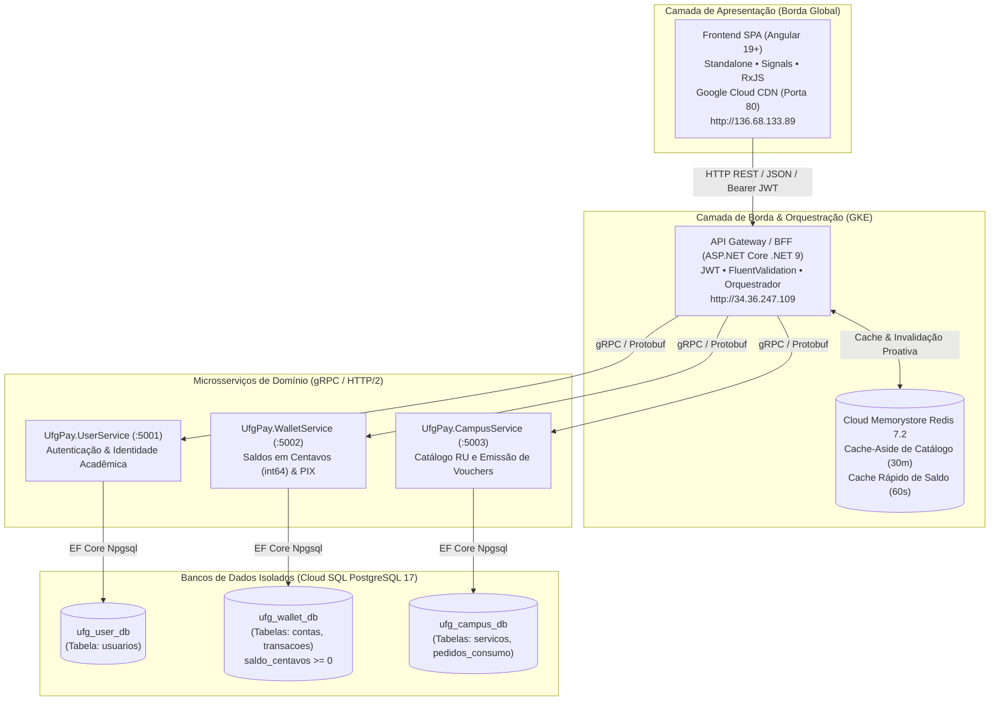
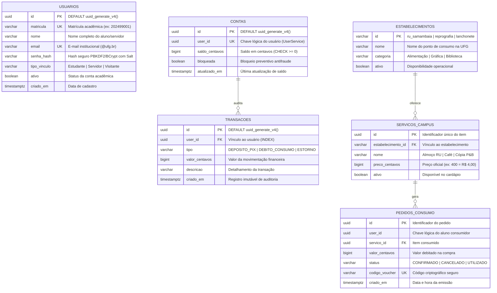

# 🎓 Roteiro de Apresentação Técnica - UFG Pay

**Projeto:** UFG Pay - Sistema Distribuído de Pagamentos Acadêmicos  
**Instituição:** Universidade Federal de Goiás (UFG)  

---


## 🏛️ Arquitetura do Sistema (Padrões Implementados)



### Destaques Arquiteturais:
1. **Database-per-Service:** Nenhuma tabela é compartilhada entre microsserviços. O isolamento é total entre identidade acadêmica (`ufg_user_db`), transações financeiras (`ufg_wallet_db`) e consumo do RU (`ufg_campus_db`).
2. **Comunicação Binária gRPC (HTTP/2):** O Gateway orquestra chamadas com contratos tipados e serialização Protocol Buffers (`.proto3`), proporcionando altíssima performance e baixíssima latência.
3. **Precisão Financeira Estrita:** Saldos e valores manipulados exclusivamente em **centavos (`int64` / `BIGINT`)** com constraint no PostgreSQL (`saldo_centavos >= 0`), eliminando qualquer risco de inconsistência por ponto flutuante.
4. **Resiliência com Padrão de Compensação:** Se o débito ocorrer no `WalletService` mas a geração do voucher falhar no `CampusService`, o Gateway realiza estorno automático do valor para a carteira do estudante.

---

## 🚦 Matriz de Validação dos Status HTTP

| Status HTTP | Endpoint | Cenário Prático na Demonstração | Como Disparar ao Vivo |
| :--- | :--- | :--- | :--- |
| **`400 Bad Request`** | `POST /api/v1/auth/register` | Tentativa de cadastro com dados inválidos ou e-mail fora do padrão institucional. | No formulário de cadastro, tente submeter matrícula vazia ou senha com menos de 6 caracteres. O FluentValidation intercepta e retorna 400. |
| **`400 Bad Request`** | `POST /api/v1/campus/checkout` | Tentativa de compra no RU com saldo insuficiente na carteira. | Tente comprar uma refeição de R$ 4,00 com a conta recém-criada (saldo R$ 0,00). O Gateway recusa e retorna 400. |
| **`400 Bad Request`** | `POST /api/v1/wallet/topup-pix` | Valor de recarga inválido ($\le$ 0). | Tente enviar valor zerado ou negativo via Swagger. Retorna 400. |
| **`401 Unauthorized`** | `POST /api/v1/auth/login` | Tentativa de login com senha incorreta ou matrícula inexistente. | Digite sua matrícula e uma senha incorreta no formulário de login. Retorna 401. |
| **`401 Unauthorized`** | `GET /api/v1/wallet/balance` | Chamada a endpoint protegido sem token JWT. | Abra o Swagger (`http://34.36.247.109`) e execute o `GET /api/v1/wallet/balance` sem autorizar o Bearer token. Retorna 401. |
| **`200 OK`** | `POST /api/v1/auth/login` | Login institucional com credenciais válidas. | Faça login com as credenciais cadastradas. Retorna 200 com token JWT. |
| **`200 OK`** | `GET /api/v1/wallet/balance` | Consulta de saldo autenticada. | Exibição do card de saldo no dashboard do estudante. Retorna 200 (servido pelo Redis em $\approx 2\text{ms}$). |
| **`200 OK`** | `POST /api/v1/wallet/topup-pix` | Depósito/Recarga via PIX com sucesso. | Realize uma recarga de R$ 20,00 na tela do PIX. O saldo atualiza instantaneamente com retorno 200. |
| **`201 Created`** | `POST /api/v1/auth/register` | Cadastro do estudante e criação automática da carteira digital. | Preencha o cadastro completo de um novo aluno. O Gateway cria o usuário no `UserService`, cria a carteira no `WalletService` e retorna 201. |
| **`201 Created`** | `POST /api/v1/campus/checkout` | Compra de refeição no RU e emissão do voucher de consumo. | Com saldo na conta, compre a refeição de estudante (R$ 4,00). O voucher é emitido e retorna 201. |

---

## 🎬 Endereços

### Passo 1
Deixe 3 abas abertas no navegador:
1. **Aba 1 (Frontend):** `http://136.68.133.89`
2. **Aba 2 (Swagger da API Gateway):** `http://34.36.247.109`
3. **Aba 3 (Terminal Cloud Shell):** Conectado com o comando `psql` para provar a persistência no banco.

---


## 🗄️ Estrutura do Banco de Dados e Modelagem Relacional

O UFG Pay implementa o padrão **Database-per-Service**, garantindo isolamento total de esquemas, ciclo de vida e concorrência através de 3 bases lógicas no **PostgreSQL 17**:



### Detalhamento das 3 Bases de Dados:

#### 1. `ufg_user_db` (Gestão de Identidade Acadêmica)
- **Tabela `usuarios`**: Armazena cadastros acadêmicos.
  - Índices únicos: `idx_usuarios_matricula` e `idx_usuarios_email`.
  - Senhas protegidas por hash criptográfico seguro (nenhuma senha é salva em texto puro).

#### 2. `ufg_wallet_db` (Core Bancário & Carteira Digital)
- **Tabela `contas`**: Armazena o saldo em moeda soberana digital.
  - **Constraint Financeira Crítica**: `CONSTRAINT chk_saldo_positivo CHECK (saldo_centavos >= 0)` que impede saldo negativo diretamente no motor do PostgreSQL.
- **Tabela `transacoes`**: Livro-razão contábil (*ledger*) imutável para auditoria de cada recarga PIX, pagamento no RU ou estorno de compensação.

#### 3. `ufg_campus_db` (Catálogo e Vouchers de Consumo)
- **Tabela `estabelecimentos`**: Locais físicos credenciados nos campi (Samambaia, Colemar, INF, Gráfica).
- **Tabela `servicos_campus`**: Cardápio oficial e taxas (Almoço RU R$ 4,00, Café R$ 2,50, etc.).
- **Tabela `pedidos_consumo`**: Vouchers digitais emitidos. Possui o índice único `idx_pedidos_voucher` sobre `codigo_voucher` para validação imediata nos balcões.

---

## 🗄️ Comprovação de Persistência Real no Banco de Dados (Sem Mocks)

Para comprovar à banca examinadora que todos os dados são persistidos de verdade e sem dados simulados (mocks), você pode demonstrar tanto pela **interface online do Google Cloud** quanto pelo **terminal**:

### 🌐 Opção A: Visualização Online no Navegador (Cloud SQL Studio)

O Google Cloud possui o **Cloud SQL Studio**, um gerenciador de banco de dados nativo no navegador onde você pode abrir as tabelas e rodar consultas com um clique:

- 📊 **Link Direto do Cloud SQL Studio (Query Editor Online):**  
  👉 **[https://console.cloud.google.com/sql/instances/ufgpay-prod-postgres17/studio?project=ufg-pay-12432](https://console.cloud.google.com/sql/instances/ufgpay-prod-postgres17/studio?project=ufg-pay-12432)**  
  *(Selecione o banco `ufg_user_db`, `ufg_wallet_db` ou `ufg_campus_db`, autentique com o usuário `ufgpay_app` e execute os comandos SQL diretamente no navegador).*

- 🗂️ **Link da Lista das 3 Bases de Dados (Database-per-Service):**  
  👉 **[https://console.cloud.google.com/sql/instances/ufgpay-prod-postgres17/databases?project=ufg-pay-12432](https://console.cloud.google.com/sql/instances/ufgpay-prod-postgres17/databases?project=ufg-pay-12432)**  
  *(Mostre as 3 bases independentes criadas: `ufg_user_db`, `ufg_wallet_db` e `ufg_campus_db`).*

- ⚙️ **Visão Geral da Instância de Produção:**  
  👉 **[https://console.cloud.google.com/sql/instances/ufgpay-prod-postgres17/overview?project=ufg-pay-12432](https://console.cloud.google.com/sql/instances/ufgpay-prod-postgres17/overview?project=ufg-pay-12432)**

---

### 💻 Opção B: Consulta Rápida via Terminal (Cloud Shell)

**Credenciais Oficiais:**
- **Host do Banco (IP Privado VPC):** `$DB_HOST`
- **Usuário:** `ufgpay_app`
- **Senha Oficial de Produção:** `oeQAJ<Sfc!Yfddal0iA6([*seTw!}N}[`

---

### Demonstrar no Cloud Shell:

No seu terminal do Google Cloud Shell, execute:

```bash
# 1. Captura o IP privado do PostgreSQL automaticamente
export DB_HOST=$(gcloud sql instances describe ufgpay-prod-postgres17 --project=ufg-pay-12432 --format='value(ipAddresses.filter(type:PRIVATE).ipAddress)')
export DB_PASS='oeQAJ<Sfc!Yfddal0iA6([*seTw!}N}['

# 2. Inicia o cliente PostgreSQL interativo dentro do cluster GKE
kubectl run psql-client --rm -i --tty --image=postgres:17-alpine --namespace=ufgpay \
  --env="DB_HOST=$DB_HOST" \
  --env="PGPASSWORD=$DB_PASS" \
  -- /bin/sh
```

Assim que o prompt `#` abrir dentro do pod, execute as consultas reais:

#### 1. Provar Aluno Cadastrado (`ufg_user_db`):
```sql
psql -h $DB_HOST -U ufgpay_app -d ufg_user_db -c "
SELECT id, matricula, nome, email, tipo_vinculo, criado_em FROM usuarios;
"
```

#### 2. Provar Saldo e Extrato Real da Carteira (`ufg_wallet_db`):
```sql
psql -h $DB_HOST -U ufgpay_app -d ufg_wallet_db -c "
SELECT user_id, saldo_centavos, atualizado_em FROM contas;
SELECT user_id, tipo, valor_centavos, descricao, criado_em FROM transacoes ORDER BY criado_em DESC;
"
```


#### 3. Provar o Voucher Emitido (`ufg_campus_db`):
```sql
psql -h $DB_HOST -U ufgpay_app -d ufg_campus_db -c "
SELECT id, user_id, valor_centavos, status, codigo_voucher, criado_em FROM pedidos_consumo ORDER BY criado_em DESC;
"
```

---

### Links
BD: https://console.cloud.google.com/sql/instances?project=ufg-pay-12432
cache: https://console.cloud.google.com/memorystore/redis/instances?project=ufg-pay-12432
back: https://console.cloud.google.com/kubernetes/workload/overview?project=ufg-pay-12432
front: https://console.cloud.google.com/storage/browser?project=ufg-pay-12432 e https://console.cloud.google.com/net-services/loadbalancing/loadBalancers/list?project=ufg-pay-12432
docker: https://console.cloud.google.com/artifacts?project=ufg-pay-12432