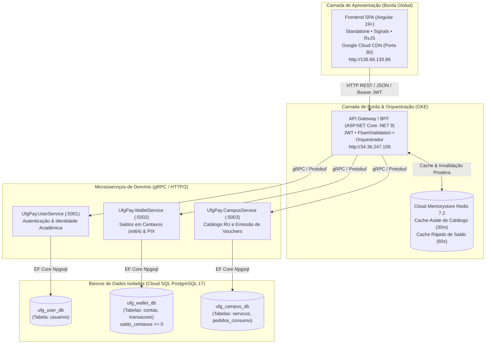

# 🎓 Roteiro de Apresentação Técnica - UFG Pay

**Projeto:** UFG Pay - Sistema Distribuído de Pagamentos Acadêmicos  
**Instituição:** Universidade Federal de Goiás (UFG)  
**Tempo Limite:** 10 minutos *(Rigoroso: exceder o tempo zera o quesito oral)*  
**Ambiente:** Google Cloud Platform (GCP) em Produção + GKE + Cloud CDN

---

## ⏱️ Cronograma da Apresentação (10 Minutos)

| Bloco | Tempo | Foco | O que Demonstrar |
| :--- | :--- | :--- | :--- |
| **1. Introdução & Arquitetura** | 0:00 - 1:45 *(1m45s)* | Contexto e Engenharia | Problema da UFG, padrão Database-per-Service, gRPC binário e Cache Redis. |
| **2. Código & Contratos** | 1:45 - 3:00 *(1m15s)* | Código & Padrões | Contratos `.proto`, Clean Architecture, Middlewares do Gateway e FluentValidation. |
| **3. Demonstração Prática (Ao Vivo)** | 3:00 - 7:30 *(4m30s)* | Jornada Ponta a Ponta | Frontend $\rightarrow$ Gateway $\rightarrow$ gRPC $\rightarrow$ Validação dos status HTTP (**400, 401, 200, 201**). |
| **4. Persistência Real no Banco** | 7:30 - 8:45 *(1m15s)* | Prova Real (Sem Mocks) | Consulta ao vivo das tabelas Postgres (`usuarios`, `contas`, `transacoes`, `pedidos_consumo`). |
| **5. Conclusão & Tolerância a Falhas** | 8:45 - 9:45 *(1m00s)* | Diferenciais Técnicos | Compensação atômica (estorno automático), cache-aside e precisão em centavos. |
| **Buffer de Segurança** | 9:45 - 10:00 *(15s)* | Encerramento | Agradecimentos e abertura para perguntas da banca. |

---

## 🏛️ Arquitetura do Sistema (Padrões Implementados)



### Destaques Arquiteturais para Defender na Apresentação:
1. **Database-per-Service:** Nenhuma tabela é compartilhada entre microsserviços. O isolamento é total entre identidade acadêmica (`ufg_user_db`), transações financeiras (`ufg_wallet_db`) e consumo do RU (`ufg_campus_db`).
2. **Comunicação Binária gRPC (HTTP/2):** O Gateway orquestra chamadas com contratos tipados e serialização Protocol Buffers (`.proto3`), proporcionando altíssima performance e baixíssima latência.
3. **Precisão Financeira Estrita:** Saldos e valores manipulados exclusivamente em **centavos (`int64` / `BIGINT`)** com constraint no PostgreSQL (`saldo_centavos >= 0`), eliminando qualquer risco de inconsistência por ponto flutuante.
4. **Resiliência com Padrão de Compensação:** Se o débito ocorrer no `WalletService` mas a geração do voucher falhar no `CampusService`, o Gateway realiza estorno automático do valor para a carteira do estudante.

---

## 🚦 Matriz de Validação dos Status HTTP (Obrigatório: 60% da Nota)

| Status HTTP | Endpoint | Cenário Prático na Demonstração | Como Disparar ao Vivo |
| :--- | :--- | :--- | :--- |
| **`400 Bad Request`** | `POST /api/v1/auth/register` | Tentativa de cadastro com dados inválidos ou e-mail fora do padrão institucional. | No formulário de cadastro, tente submeter matrícula vazia ou senha com menos de 6 caracteres. O FluentValidation intercepta e retorna 400. |
| **`400 Bad Request`** | `POST /api/v1/campus/checkout` | Tentativa de compra no RU com saldo insuficiente na carteira. | Tente comprar uma refeição de R$ 4,00 com a conta recém-criada (saldo R$ 0,00). O Gateway recusa e retorna 400. |
| **`400 Bad Request`** | `POST /api/v1/wallet/topup-pix` | Valor de recarga inválido ($\le$ 0). | Tente enviar valor zerado ou negativo via Swagger. Retorna 400. |
| **`401 Unauthorized`** | `POST /api/v1/auth/login` | Tentativa de login com senha incorreta ou matrícula inexistente. | Digite sua matrícula e uma senha incorreta no formulário de login. Retorna 401. |
| **`401 Unauthorized`** | `GET /api/v1/wallet/balance` | Chamada a endpoint protegido sem token JWT. | Abra o Swagger (`http://34.36.247.109`) e execute o `GET /api/v1/wallet/balance` sem autorizar o Bearer token. Retorna 401. |
| **`200 OK`** | `POST /api/v1/auth/login` | Login institucional com credenciais válidas. | Faça login com as credenciais cadastradas. Retorna 200 com token JWT. |
| **`200 OK`** | `GET /api/v1/wallet/balance` | Consulta de saldo autenticada. | Exibição do card de saldo no dashboard do estudante. Retorna 200 (servido pelo Redis em $\approx 2\text{ms}$). |
| **`200 OK`** | `POST /api/v1/wallet/topup-pix` | Depósito/Recarga via PIX com sucesso. | Realize uma recarga de R$ 20,00 na tela do PIX. O saldo atualiza instantaneamente com retorno 200. |
| **`201 Created`** | `POST /api/v1/auth/register` | Cadastro do estudante e criação automática da carteira digital. | Preencha o cadastro completo de um novo aluno. O Gateway cria o usuário no `UserService`, cria a carteira no `WalletService` e retorna 201. |
| **`201 Created`** | `POST /api/v1/campus/checkout` | Compra de refeição no RU e emissão do voucher de consumo. | Com saldo na conta, compre a refeição de estudante (R$ 4,00). O voucher é emitido e retorna 201. |

---

## 🎬 Roteiro Prático da Demonstração (Passo a Passo)

### Passo 1: Abrir as Abas no Navegador Antes de Começar
Deixe 3 abas abertas no navegador:
1. **Aba 1 (Frontend):** `http://136.68.133.89`
2. **Aba 2 (Swagger da API Gateway):** `http://34.36.247.109`
3. **Aba 3 (Terminal Cloud Shell):** Conectado com o comando `psql` para provar a persistência no banco.

---

### Passo 2: Demonstração da Jornada (3:00 - 7:30)

1. **Provando o `400 Bad Request` (Validação):**
   - Acesse a tela de cadastro no Frontend.
   - Digite um e-mail inválido (ex: `teste@gmail.com` em vez do padrão institucional) ou deixe campos vazios.
   - Abra o **DevTools (F12 $\rightarrow$ Network)** e clique em Cadastrar.
   - **Mostre à banca:** O Gateway interceptou via `FluentValidation` e retornou **HTTP 400 Bad Request**.

2. **Provando o `201 Created` (Criação Atômica):**
   - Preencha os dados válidos:
     - Nome: `Aluno Teste UFG`
     - Matrícula: `202499001`
     - E-mail: `alunoteste@discente.ufg.br`
     - Senha: `SenhaSegura123!`
     - Vínculo: `Estudante`
   - Clique em **Criar Conta**.
   - **Mostre à banca:** Status **HTTP 201 Created**.
   - Explique que o Gateway orquestrou duas chamadas gRPC: registrou o usuário no `UserService` e inicializou atômica e imediatamente a conta no `WalletService` com saldo R$ 0,00.

3. **Provando o `401 Unauthorized` (Segurança):**
   - Saia para a tela de login.
   - Digite a matrícula `202499001` e a senha errada `123456`.
   - Clique em Entrar.
   - **Mostre à banca:** O `UserService` validou o hash criptográfico e o Gateway retornou **HTTP 401 Unauthorized**.

4. **Provando o `200 OK` (Login & JWT):**
   - Digite a senha correta `SenhaSegura123!`.
   - Clique em Entrar.
   - **Mostre à banca:** Retorno **HTTP 200 OK** com o token JWT gerado e redirecionamento para o Dashboard.

5. **Provando o `400 Bad Request` no Checkout (Saldo Insuficiente):**
   - No Dashboard, note que o saldo inicial é `R$ 0,00`.
   - Vá para o **Catálogo do RU / Campus**.
   - Tente comprar o Almoço Estudante (R$ 4,00).
   - **Mostre à banca:** Status **HTTP 400 Bad Request** com a mensagem *"Saldo insuficiente para realizar a compra"*.

6. **Provando o `200 OK` (Recarga PIX & Invalidação de Cache):**
   - Vá na aba **Recarga PIX**.
   - Digite o valor de `R$ 20,00` e confirme.
   - **Mostre à banca:** Retorno **HTTP 200 OK**. O saldo agora é `R$ 20,00`.
   - Destaque que o saldo anterior em cache no Redis foi invalidado proativamente e atualizado.

7. **Provando o `201 Created` (Checkout & Emissão de Voucher):**
   - Volte ao **Catálogo do RU**.
   - Compre a refeição de `R$ 4,00`.
   - **Mostre à banca:** Retorno **HTTP 201 Created**.
   - O saldo cai para `R$ 16,00` e o **Voucher Digital** com código alfanumérico seguro é exibido na tela para ser apresentado na catraca do RU!

---

## 🗄️ Comprovação de Persistência Real no Banco de Dados (Sem Mocks)

Abra o Cloud Shell e rode as consultas abaixo para provar à banca que todos os dados foram gravados diretamente nos bancos PostgreSQL:

### 1. Conectar via Cloud Shell ao PostgreSQL 17:
```bash
# Executa um container temporário conectado ao IP privado do banco via rede VPC
kubectl run psql-client --rm -i --tty --image=postgres:17-alpine --namespace=ufgpay -- /bin/sh
```

Dentro do shell do cliente, conecte-se a cada um dos 3 bancos:

### 2. Provar Usuário Cadastrado (`ufg_user_db`):
```sql
PGPASSWORD='SUA_SENHA_DO_BANCO' psql -h 10.60.0.3 -U ufgpay_app -d ufg_user_db

SELECT id, matricula, nome, email, tipo_vinculo, criado_em FROM usuarios;
```
*(Mostre a linha com o aluno recém-cadastrado `202499001`!)*

### 3. Provar Saldo e Transações Financeiras (`ufg_wallet_db`):
```sql
PGPASSWORD='SUA_SENHA_DO_BANCO' psql -h 10.60.0.3 -U ufgpay_app -d ufg_wallet_db

-- Ver a conta e o saldo em centavos (1600 centavos = R$ 16,00)
SELECT user_id, saldo_centavos, atualizado_em FROM contas;

-- Ver o extrato real (o depósito PIX de R$ 20,00 e o débito do RU de R$ 4,00)
SELECT user_id, tipo, valor_centavos, descricao, criado_em FROM transacoes;
```

### 4. Provar o Voucher e Pedido de Consumo (`ufg_campus_db`):
```sql
PGPASSWORD='SUA_SENHA_DO_BANCO' psql -h 10.60.0.3 -U ufgpay_app -d ufg_campus_db

SELECT id, user_id, valor_centavos, status, codigo_voucher, criado_em FROM pedidos_consumo;
```
*(Mostre o código do voucher gerado que é exatamente o mesmo exibido na tela do estudante!)*

---

## 💡 Dicas de Ouro para a Apresentação Oral (10% da Nota)

1. **Domínio do Tempo:**
   - Pratique o roteiro com um cronômetro no celular. O ideal é terminar a demonstração entre **8min30s e 9min00s**, deixando 1 minuto de margem.
2. **Linguagem Técnica Precisa:**
   - Diga: *"Adotamos o padrão Database-per-Service para isolamento de falhas..."*
   - Diga: *"A comunicação interna é via gRPC HTTP/2 binário sobre contratos Protocol Buffers versão 3..."*
   - Diga: *"O saldo é modelado estritamente em centavos int64 com check constraint no PostgreSQL para impedir saldo negativo a nível de banco..."*
   - Diga: *"Implementamos Cache-Aside no Redis com invalidação proativa no evento de escrita..."*
3. **Se a banca perguntar sobre Mocks:**
   - Mostre as tabelas do PostgreSQL e a aba Network do DevTools provando que cada clique aciona o Gateway e grava nos bancos de dados gerenciados no Cloud SQL.
