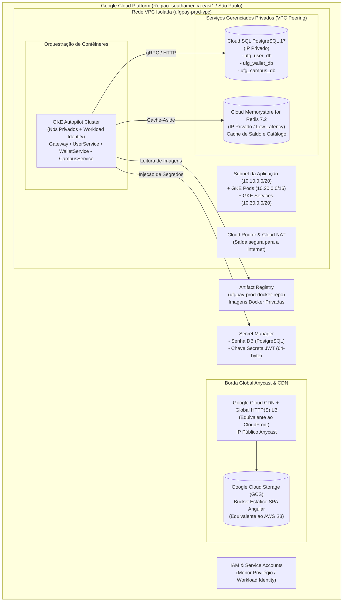
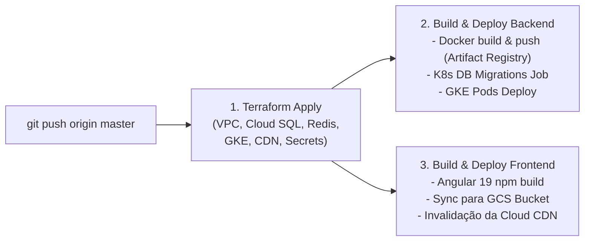

# ☁️ Infraestrutura como Código (Terraform) - Google Cloud Platform (GCP)

Este diretório contém a especificação de **Infraestrutura como Código (IaC)** com **Terraform**, manifestos de **Kubernetes (GKE)** e a pipeline de **CI/CD no GitHub Actions** para provisionar e publicar continuamente o ecossistema distribuído do **UFG Pay** no **Google Cloud Platform (GCP)**.

---

## 🏛️ Recursos Provisionados no Google Cloud



---

## 🌐 Frontend com Cloud CDN (Equivalente AWS S3 + CloudFront)

Na AWS, utiliza-se comumente a dupla **S3 + CloudFront**. No **Google Cloud**, a solução canônica e de mais alta performance implementada neste repositório é:

1. **Google Cloud Storage (GCS) - `google_storage_bucket`**:
   - Atua como repositório dos artefatos estáticos compilados do Angular (`dist/ufg-pay-web/browser`).
   - Configurado no modo `website` com `main_page_suffix = "index.html"` e `not_found_page = "index.html"`, garantindo o suporte nativo a roteamento SPA (Single Page Application).
2. **Google Cloud CDN - `google_compute_backend_bucket`**:
   - Cache de borda global nos pontos de presença (PoPs) mundiais do Google.
   - Baixa latência para estudantes e servidores no Brasil e no exterior.
3. **Global External Application Load Balancer - `google_compute_global_forwarding_rule`**:
   - Fornece um **Endereço IP Anycast público global** na porta 80/443.
   - Roteamento inteligente com suporte a SSL gerenciado pela Google.

---

## 🚀 CI/CD Automatizado no GitHub Actions

Sempre que um **commit ou merge** for realizado na branch **`master`**, a pipeline [`.github/workflows/deploy-prod.yml`](../.github/workflows/deploy-prod.yml) é disparada automaticamente para:



### Configuração de Secrets no GitHub Repository:
Para ativar a esteira no GitHub, adicione os seguintes segredos em **Settings $\rightarrow$ Secrets and variables $\rightarrow$ Actions**:

1. **`GCP_PROJECT_ID`**: O ID do seu projeto no Google Cloud (ex: `ufgpay-cloud-prod`).
2. **`GCP_SA_KEY`**: Chave de Service Account em formato JSON com permissões de `Owner` ou `Editor` + `Secret Manager Admin` + `Security Admin`.
3. *(Opcional)* **`GCP_REGION`**: Região padrão (caso não seja `southamerica-east1`).

---

## 📁 Estrutura de Arquivos da Infraestrutura

```text
infra/
├── .gitignore                # Protege estados locais (.tfstate) e senhas
├── versions.tf               # Versão do Terraform e providers (google, google-beta, random)
├── variables.tf              # Variáveis configuráveis (project_id, region, tiers)
├── terraform.tfvars.example  # Template de variáveis para preenchimento
├── main.tf                   # Habilitação automatizada de todas as APIs do GCP
├── networking.tf             # VPC customizada, subnets, Cloud NAT e VPC Peering
├── frontend_cdn.tf           # GCS Bucket + Cloud CDN + Global Anycast IP (Equivalente AWS S3 + CloudFront)
├── artifact_registry.tf      # Repositório Docker privado para os contêineres
├── secrets.tf                # Secret Manager com senhas criptográficas e chave JWT
├── database.tf               # Cloud SQL PostgreSQL 17 (3 bancos: user, wallet, campus)
├── redis.tf                  # Memorystore for Redis 7.2
├── gke.tf                    # Cluster GKE Autopilot com nós privados
├── iam.tf                    # Service Accounts e permissões de menor privilégio
├── outputs.tf                # Outputs com comandos, credenciais e URL da CDN
│
└── k8s/                      # Manifestos Kubernetes para o GKE
    ├── namespace.yaml        # Namespace 'ufgpay'
    ├── configmap.yaml        # Configurações globais e URLs internas gRPC
    ├── db-init-job.yaml      # Job de execução de Migrations e Seeds nos bancos
    ├── user-service.yaml     # Deployment & Service gRPC :5001
    ├── wallet-service.yaml   # Deployment & Service gRPC :5002
    ├── campus-service.yaml   # Deployment & Service gRPC :5003
    ├── gateway.yaml          # Deployment & Service HTTP :5000
    └── ingress.yaml          # Ingress externo gerenciado pelo Google Cloud
```

---

## 🛠️ Execução Manual Local do Terraform (Opcional)

Se preferir rodar manualmente na sua máquina antes de subir para o GitHub:

```bash
cd infra
cp terraform.tfvars.example terraform.tfvars
# Edite o project_id no arquivo terraform.tfvars

gcloud auth application-default login
terraform init
terraform plan
terraform apply
```

### Comandos Úteis Pós-Deploy:

- **Acessar o Frontend na CDN**:
  O Terraform exibirá a URL no output `frontend_url` (ex: `http://34.x.x.x`).
- **Autenticar o kubectl no cluster GKE**:
  ```bash
  gcloud container clusters get-credentials ufgpay-prod-gke-cluster --region southamerica-east1 --project SEU_PROJECT_ID
  ```
- **Verificar os pods no Kubernetes**:
  ```bash
  kubectl get pods -n ufgpay
  ```
- **Consultar a senha do banco no Secret Manager**:
  ```bash
  gcloud secrets versions access latest --secret="ufgpay-prod-db-password" --project=SEU_PROJECT_ID
  ```
